# FUSE — White-label Music Player UI/UX Fusion

<p align="center">
  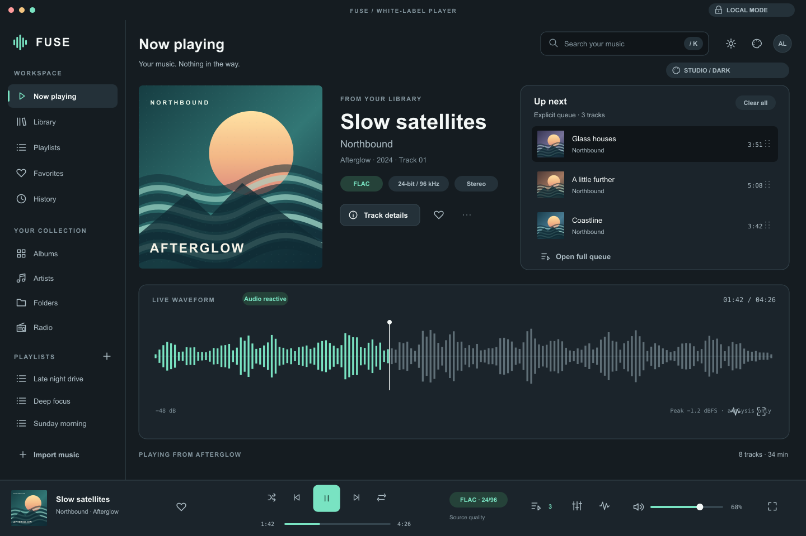
</p>

<p align="center">
  <a href="FUSE-Complete-Design.md"></a>
  <a href="exports/formats/FUSE-Complete-Design.pdf"></a>
  <a href="exports/formats/FUSE-Complete-Design.docx"></a>
  <a href="LICENSE"></a>
</p>

> **One player. Three lineages. No borrowed branding.**
> FUSE fuses Winamp’s modular performance controls and skin culture, VOX’s compact album-led restraint, and AIMP’s deep library, queue, tagging, and audio tooling into an original, white-label product system — not a reproduction of any reference application.

---

## Table of Contents

- [Overview](#overview)
- [Lineage & Fusion Decisions](#lineage--fusion-decisions)
- [Product Principles](#product-principles)
- [Feature Inventory](#feature-inventory)
- [Information Architecture](#information-architecture)
- [Playback & Queue Semantics](#playback--queue-semantics)
- [Layout System & Modes](#layout-system--modes)
- [Visual Language & Tokens](#visual-language--tokens)
- [Component Inventory](#component-inventory)
- [Waveform, Spectrum & Motion](#waveform-spectrum--motion)
- [Skin & White-label Contract](#skin--white-label-contract)
- [Accessibility](#accessibility)
- [Gallery](#gallery)
- [Implementation Handoff](#implementation-handoff)
- [Validation & Acceptance](#validation--acceptance)
- [Roadmap](#roadmap)
- [Repository Structure](#repository-structure)
- [Exports](#exports)
- [Source Notes & Limitations](#source-notes--limitations)

---

## Overview

FUSE is a **high-fidelity, SVG-first design specification and vector prototype** for a white-label desktop music player. It is not a shipped audio engine: there is no production decoder, database, native file-permission layer, or platform media-session integration yet. What exists is a complete, implementation-ready design package:

- 50 original vector screen/component designs (SVG + PNG)
- A 20-section design specification (analysis, IA, flows, tokens, components, accessibility, validation)
- Machine-readable design tokens, themes, and a data-only skin schema
- An interactive waveform lab demonstrating real audio-driven SVG updates
- Exported deliverables in HTML, PDF, DOCX, ODT, EPUB

**Core value proposition:** a calm, album-led listening workspace that can expand into a powerful audio workstation, shrink into a compact performance player, and change its entire visual signature — without changing how it behaves.

---

## Lineage & Fusion Decisions

| Lineage | Adopted strength | Modernized expression |
|---|---|---|
| **Classic Winamp** | Immediate transport, visible spectrum, modular player/EQ/playlist stack, skin identity | Original vector metal skin, readable labels, modern target sizes, shared state across modules |
| **VOX for macOS** | Compact footprint, artwork-first hierarchy, restrained controls, source-format awareness | Persistent now-playing identity, quiet chrome, explicit quality badges, mini/shade modes |
| **AIMP** | Library depth, explicit queue, smart playlists, tagging, DSP, flexible skins | Task-grouped navigation, safe batch editing, capability-aware audio settings, tokenized skin system |

### Cross-product resolution

| Aspect | FUSE resolution |
|---|---|
| First impression | Album-led workspace; tools one click away |
| Transport | Persistent shared transport; compact variant |
| Queue | Separate "Play next" and "Then resumes at" regions |
| Library | Albums / tracks / artists / folders + smart playlists |
| EQ | 10-band default; advanced chain capability-gated |
| Visualizer | Four honest modes, pausable, SVG-driven |
| Skins | Semantic tokens + approved layout variants |
| Quality | Source / DSP / output facts separated |
| Accessibility | Targets, focus, contrast, motion, semantics locked |
| Safety | Explicit queue removal, tag save, file deletion boundaries |

---

## Product Principles

1. **Playback is always recoverable.** Play/pause, track identity, and an exit from compact/focus modes remain reachable.
2. **Queue is explicit.** "Play next," playlist context, selection, and history are different objects with different visual treatments.
3. **Power is progressive.** A new user can import and play without understanding DSP, exclusive output, or skin tokens.
4. **Quality claims are precise.** Source format, processing state, and negotiated output are separate facts.
5. **Skins cannot break usability.** Color, texture, and approved layout variants are customizable; control meaning, focus, targets, and error honesty are not.
6. **Motion is optional.** Reactive visuals are pausable with a static presentation; reduced motion is respected.
7. **Local files are safe.** Import does not modify files; tag writes, deletion, and renaming are separate explicit operations.
8. **Every state tells the truth.** Loading, buffering, paused, stopped, unavailable, and error are not interchangeable.

---

## Feature Inventory

**P0** = required for a coherent local player · **P1** = strong differentiator · **P2** = conditional extension · **R** = research before commitment

| Area | Feature | Priority |
|---|---|---:|
| Playback | Open files/folders; play/pause/stop; prev/next; seek; volume/mute | P0 |
| Playback | Shuffle; repeat off/all/one; gapless where supported | P0/P1 |
| Playback | Resume track/position; restore queue | P1 |
| Queue | Play next; add to queue; reorder; remove; clear; undo | P0 |
| Queue | Resume visible playlist context | P0 |
| Library | Index folders; incremental scan; cancel; partial results | P0 |
| Library | Albums/tracks/artists/folders; grid/list; sort/filter | P0 |
| Library | Search across local metadata | P0 |
| Playlists | Multiple playlists; create/rename/duplicate; M3U/M3U8 export | P0/P1 |
| Playlists | Smart playlists with readable rules | P1 |
| Organization | Favorites; ratings; history; play counts | P1 |
| Metadata | Single/batch tags; mixed values; artwork; explicit save | P1 |
| Metadata | File rename preview; chapter/CUE editing | P2 |
| Sound | 10-band EQ; preamp; presets; reset; numeric values | P0/P1 |
| Sound | ReplayGain/normalization; clipping protection | P1 |
| Sound | Crossfeed; tempo/pitch; effects; 20-band EQ | P2 |
| Output | Device chooser; route-change warning | P0/P1 |
| Output | Exclusive/bit-perfect; DSD; multichannel | P2/R |
| Visuals | Waveform/spectrum/oscilloscope/static; pause | P0/P1 |
| Modes | Workspace; focus; mini; shade; Classic stack | P1 |
| Skins | Dark/light/high-contrast/Classic; token editor; import | P1 |
| Accessibility | Keyboard map; focus; zoom; reduced motion; AT semantics | P0 |
| Comfort | Sleep timer with fade/pause outcome | P1 |
| Information | Track facts; embedded/local lyrics; LRC | P1 |
| Recovery | Missing file; decode error; permissions; offline; retry | P0 |
| Privacy | Source-folder control; export; clear history/cache | P0/P1 |
| Remote | Saved radio URLs; podcasts; reconnect | P2 |
| Remote | Cloud/artwork/scrobbling/providers | P2/R |
| Tools | Converter; CD rip; recording; scheduler shutdown | P2/R |

### Progressive disclosure

- **Level 1 — Listen:** import, play, pause, next, volume, queue, search.
- **Level 2 — Organize:** playlists, favorites, history, tags, smart rules.
- **Level 3 — Shape:** EQ, presets, normalization, output, timer, skins.
- **Level 4 — Extend:** providers, advanced DSP, exclusive output, conversion, recording.

---

## Information Architecture

```
FUSE shell
├── Now playing
│   ├── Performance / artwork / signal
│   ├── Explicit queue preview
│   └── Track details / lyrics
├── Library
│   ├── Albums · Tracks · Artists · Folders
├── Playlists
│   ├── Standard · Smart · Builder
├── Favorites · History
├── Radio / Podcasts [conditional]
├── Sound studio
│   ├── EQ / presets · Processing chain · Output capabilities
├── Skin studio
│   ├── Installed skins · Token editor · Import / validation
└── Settings
    ├── Audio · Library / sources · Appearance / accessibility · Shortcuts · Privacy / data
```

Navigation rules: persistent labeled sidebar ≥1200 px; labeled horizontal tabs 900–1199 px; single-column + mini transport <900 px; mobile bottom nav only when it doesn't compete with the mini player. Sound Studio, Skin Studio, and Settings are reachable from the header and command search.

---

## Playback & Queue Semantics

### Separate objects

| Object | Meaning | Visual treatment |
|---|---|---|
| Library item | Indexed audio file and metadata | Normal row/card |
| Playback context | Ordered source: album, playlist, folder | "Playing from …" header |
| Current track | Audio actually playing or paused | Accent title + signal icon |
| Explicit queue | User-added future items overriding context | "Up next" panel + order |
| Selection | Rows targeted by a batch action | Checkbox + selection tint |
| Favorite | User-marked item | Heart/state label |
| History | Record of past playback | Timestamped list |
| Stream | Remote live source | Buffering/live badge |

### Queue algorithm

1. Playing a context sets `contextId`, `contextOrder`, `contextIndex`; it does **not** silently copy the library into the explicit queue.
2. "Play next" inserts after the current item; "Add to queue" appends.
3. At track end, consume the first explicit queue item if one exists.
4. When the explicit queue is empty, advance the context per shuffle/repeat.
5. Removing a queued item changes only the queue; undo restores position if context still valid.
6. Clearing the queue leaves the current track and context intact; shows the resume point.
7. If the resume item is unavailable, enter recovery and preserve the remaining context.
8. Shuffle affects context traversal, not the user's explicit queue order, unless "Shuffle queue" is chosen.
9. Repeat One repeats the current track only when the explicit queue is empty.
10. Mode changes never mutate queue order.

### Playback state machine

`empty → ready → loading → playing ⇄ paused / buffering → stopped / error`

States: Empty, Loading, Playing, Paused, Buffering, Stopped, Error, Offline. Each has distinct transport button, signal, seek, queue, and recovery behavior (see spec).

### Quality model

- **source**: codec, sample rate, bit depth, channels, bitrate, duration, file size, ReplayGain tags.
- **processing**: EQ enabled, preamp, normalization, crossfeed, limiter, effects, measured gain changes.
- **output**: selected device, negotiated format, exclusive/shared mode, channel mapping, backend status.

"Bit-perfect" is suppressed whenever EQ, gain, crossfeed, mixing, or unsupported conversion is active.

---

## Layout System & Modes

### Reference canvases

| Surface | Canvas | Purpose |
|---|---:|---|
| Desktop workspace | 1440 × 960 | Flagship layout and redlines |
| Medium workspace | 1100 × 820 | Tablet/small desktop reflow |
| Compact desktop | 720 × 760 content region | Single-column behavior |
| Mini player | 420 × 248 | Small persistent player |
| Shade strip | 560 × 72 | Minimal transport + identity |
| Classic stack | 880 px ref / 560 px min | Player/EQ/playlist modules |
| Mobile | 390 × 844 | Touch-first concept |

### Reflow

- ≥1200: sidebar + content + optional queue column.
- 900–1199: labeled tabs; artwork/identity and queue stack or share a row.
- <900: single column; queue opens as a sheet; transport remains persistent.
- 200% text size: action labels wrap or controls grow vertically; no clipped primary actions.
- Long titles truncate visually; full value in details/accessible name.

### Mode contract

| Mode | Keeps | Adds / changes | Must not do |
|---|---|---|---|
| Workspace | Full library + transport | Queue/signal regions | Hide core playback |
| Focus | Identity + signal + transport | Large visualization, exit | Trap without Esc/back |
| Mini | Identity + transport + expand | Compact signal | Clear queue or lose state |
| Shade | Identity + essential transport + expand | Minimal height | Hide expand or shrink targets below policy |
| Classic | Same objects/state | Modular stack, metal texture | Change queue semantics or use legacy tiny targets |

---

## Visual Language & Tokens

### Studio Dark palette

| Token | Value | Role |
|---|---|---|
| `surface.canvas` | `#101519` | Deepest background |
| `surface.shell` | `#151C21` | App shell / sidebar |
| `surface.panel` | `#1B242B` | Panels and transport |
| `surface.raised` | `#243139` | Hover / selected / raised controls |
| `border.default` | `#35454E` | Subtle separation |
| `text.primary` | `#F3F7F6` | Main text |
| `text.secondary` | `#ADBDC5` | Metadata |
| `text.tertiary` | `#84969F` | Low-emphasis labels |
| `accent.primary` | `#79E3C2` | Primary action / active signal |
| `accent.secondary` | `#F3C580` | Warm highlight / peaks |
| `focus.ring` | `#FFFFFF` | High-contrast focus indicator |

Daylight and High Contrast mappings are provided (see spec). Typography: Inter (primary) + JetBrains Mono (numericals, tabular). Scale: display 40/54 → metadata 12/16. Base spacing 4 px; steps 4, 8, 12, 16, 24, 32, 48, 64. Panel radius 12–14 px; control radius 8–10 px.

---

## Component Inventory

35 reusable components (C01–C35) with variants, required states, and rules:

| ID | Component | Variants |
|---|---|---|
| C01 | Button | Primary, secondary, quiet, destructive |
| C02 | Icon button | Ghost, solid, active |
| C03 | Split button | Primary + menu |
| C04 | Segmented control | 2–4 options |
| C05 | Tabs | Workspace, library, settings |
| C06 | Navigation item | Sidebar, header, mobile |
| C07 | Search field | Inline, command |
| C08 | Text field | Default, numeric, multiline |
| C09 | Select / combobox | Native-like, searchable |
| C10 | Checkbox | Unchecked, checked, mixed |
| C11 | Radio | Unselected, selected |
| C12 | Switch | On, off |
| C13 | Slider | Seek, volume, EQ, preamp |
| C14 | Rating | 0–5 stars |
| C15 | Badge | Format, quality, queue, live, offline |
| C16 | Transport | Full, compact, shade |
| C17 | Track row | Default, current, selected, queued, unavailable |
| C18 | Album card | Grid, compact |
| C19 | Queue item | Pending, current, resume |
| C20 | Playlist row | Standard, smart, offline |
| C21 | Progress | Determinate, indeterminate |
| C22 | Alert | Info, success, warning, error |
| C23 | Toast | Success, undo, info |
| C24 | Dialog | Confirm, form, chooser |
| C25 | Menu / popover | Context, overflow, select |
| C26 | Tooltip | Label, shortcut, explanation |
| C27 | Empty state | Library, search, lyrics, queue |
| C28 | Signal | Wave, spectrum, scope, static |
| C29 | Skin card | Installed, preview, invalid |
| C30 | Token field | Color, number, enum |
| C31 | Shortcut row | Default, recording, conflict |
| C32 | Timer chip | Duration, outcome |
| C33 | Source row | Available, offline, permission |
| C34 | Capability row | Supported, unsupported, unknown |
| C35 | Window/mode control | Mini, shade, focus, expand |

Minimum pointer target: 24 × 24 px (WCAG 2.2); design defaults 40 px desktop / 44 px touch. Focus ring: 2 px, 2 px offset, never removed.

---

## Waveform, Spectrum & Motion

Four presentation modes: **Mirrored waveform** (default), **Spectrum** (FFT, log-spaced bands), **Oscilloscope** (time-domain samples), **Static / reduced motion** (accessibility/low power).

- Audio rendering stays on the audio thread; UI never blocks it.
- Web demo uses `AnalyserNode` time-domain/frequency data (MDN).
- Target 30 fps desktop / 20 fps compact; static when paused or hidden.
- Aggregate to 96–192 waveform columns and 32–64 spectrum bands.
- Reuse SVG nodes; update attributes, don't rebuild the tree.
- Visualization pause is separate from audio pause and always reachable in focus view.
- Reduced motion defaults to static or low-rate numeric updates; no flashing/strobing.

---

## Skin & White-label Contract

### May change
Semantic colors, approved typography scale/family fallback, radius, border weight, texture, vector artwork, logo slot, signal palette, approved layout variant, density within locked minimum targets, decorative bevels in Classic mode.

### May not change
Control meaning, queue semantics, playback state truth, focus order, minimum targets, error honesty, privacy defaults, permission boundaries. No scripts, remote fetches, arbitrary HTML, or new privileged actions. No removing labels from core navigation or hiding the exit from compact/focus modes.

### Package structure
```
brand-skin/
├── manifest.json       # schema version, id, name, version, capabilities
├── tokens.json         # semantic values only
├── assets/
│   ├── logo.svg        # optional white-label mark
│   ├── texture.svg     # optional decorative vector texture
│   └── fallback-art.svg
└── preview.svg         # optional static preview
```

### Validation pipeline
Parse against schema → check schema version + required tokens → resolve colors + contrast → validate radius/density + slots → sanitize SVG (no scripts/handlers/external refs/foreignObject) → render preview (desktop/compact/mobile) → run focus/target/overflow checks → apply only after explicit confirmation; keep previous skin for undo.

### White-label slots
`brand.logo`, `brand.wordmark`, `brand.productName`, `brand.accent`, `brand.surface`, `brand.signalPalette`. Default demonstration brand is FUSE; replace via tokens/assets, not component behavior.

---

## Accessibility

Normative targets: text contrast ≥4.5:1 (large ≥3:1); non-text contrast ≥3:1; pointer targets ≥24 × 24 px (default 40/44); pause/stop/hide for moving content; reduced motion respected; core tasks usable at 200% text size.

### Keyboard contract

| Key | Action | Scope / guard |
|---|---|---|
| Space | Play/pause | Not while typing or activating a focused button |
| Left/Right | Seek ±5 s | Seekable media only |
| Shift+Left/Right | Seek ±30 s | Clamp to bounds |
| Up/Down | Volume ±1% | Transport region focused |
| M | Mute/unmute | Not while typing |
| Q | Add selection to queue | Announce count + undo |
| Alt+Up/Down | Reorder queue item | Focused queue item only |
| Ctrl/⌘+F | Search | Focus search field |
| Ctrl/⌘+, | Settings | Preserve return focus |
| Esc | Close top layer | Then leave focus view; never quit app |
| ? | Shortcut reference | Not while typing |

All bindings remappable; conflicts detected before save. Assistive technology: SVG is presentation; production controls are native/HTML hybrids with accessible names, roles, values, states. Queue changes announce item, position, count (not every frame).

---

## Gallery

50 original vector artifacts. Embedded SVG data URIs live in the full spec; renders below.

<p align="center">
  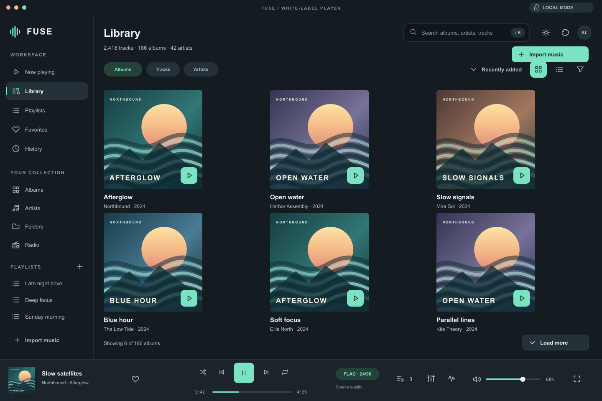
  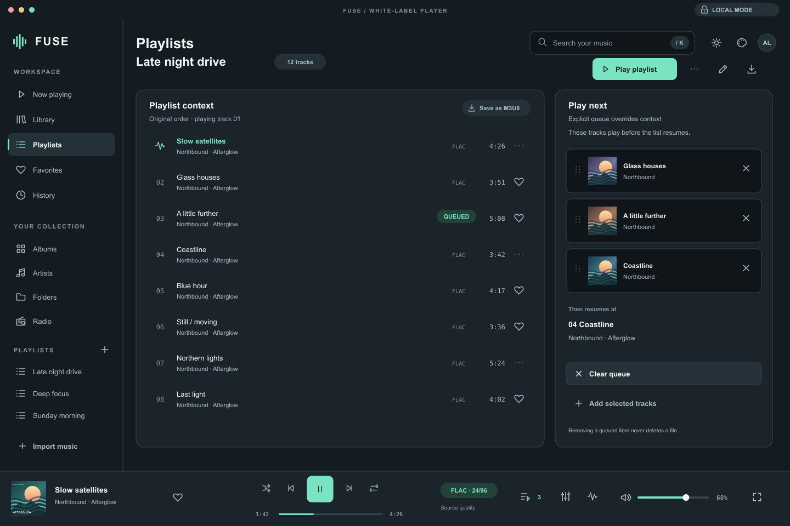
</p>
<p align="center">
  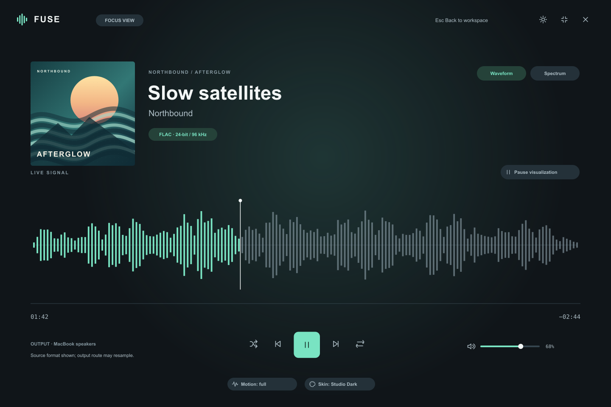
  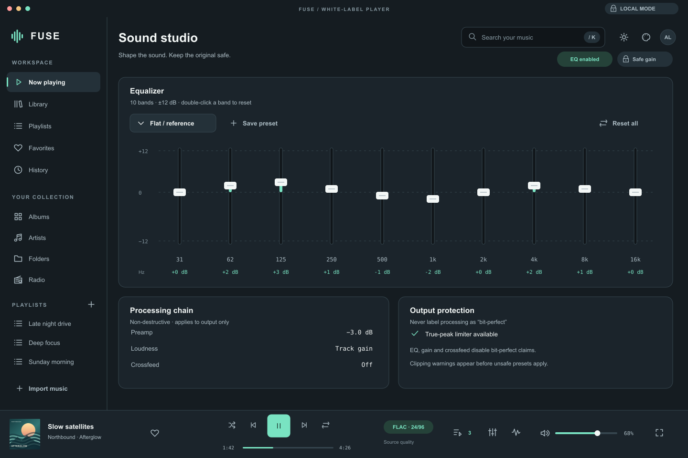
</p>
<p align="center">
  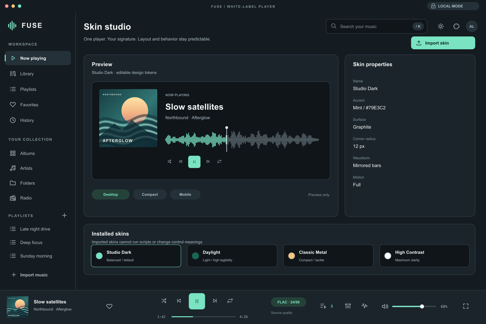
  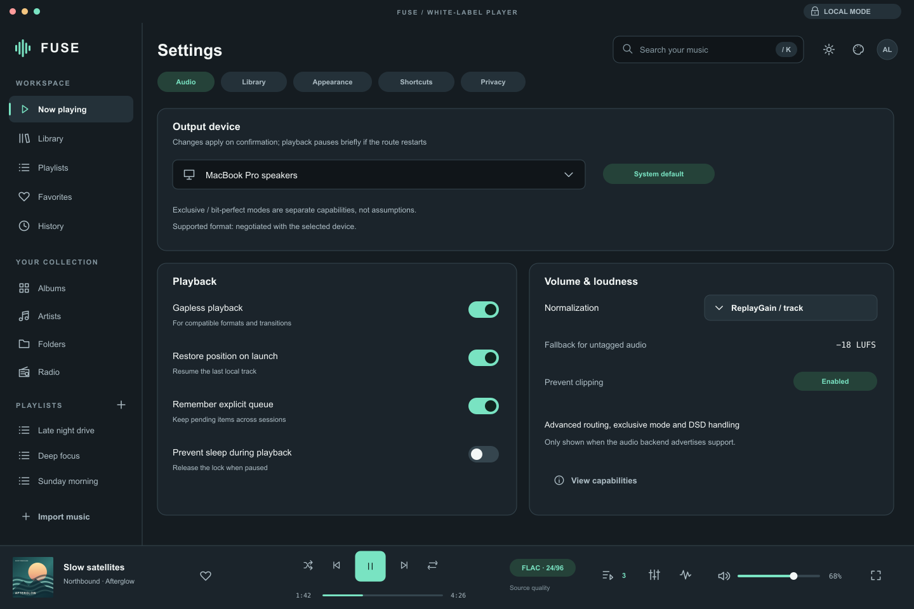
</p>
<p align="center">
  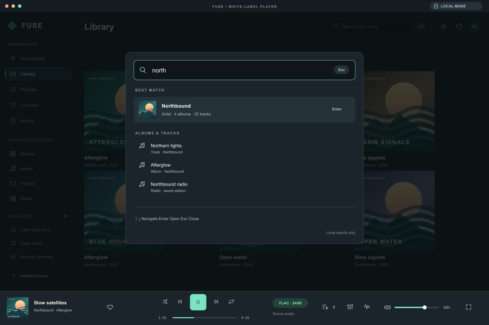
  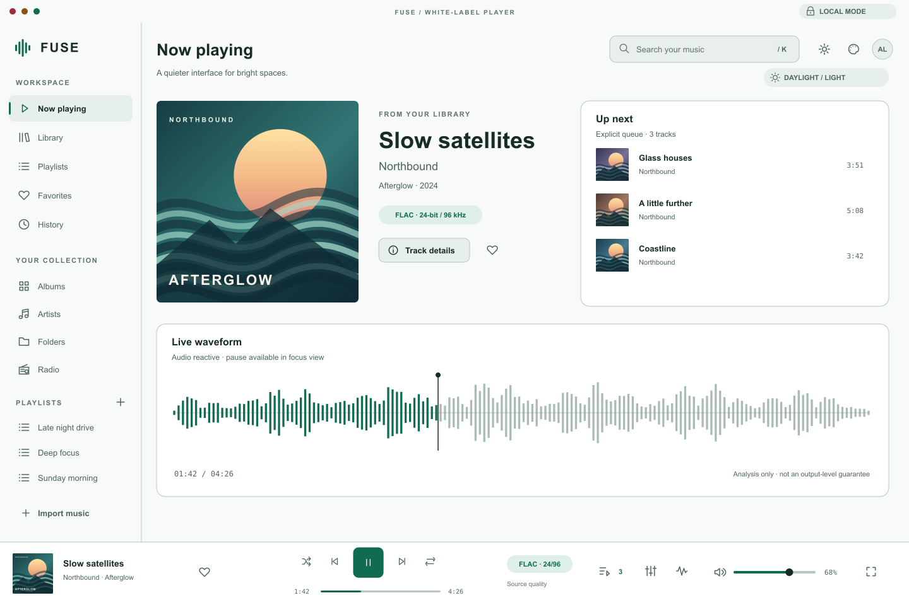
</p>
<p align="center">
  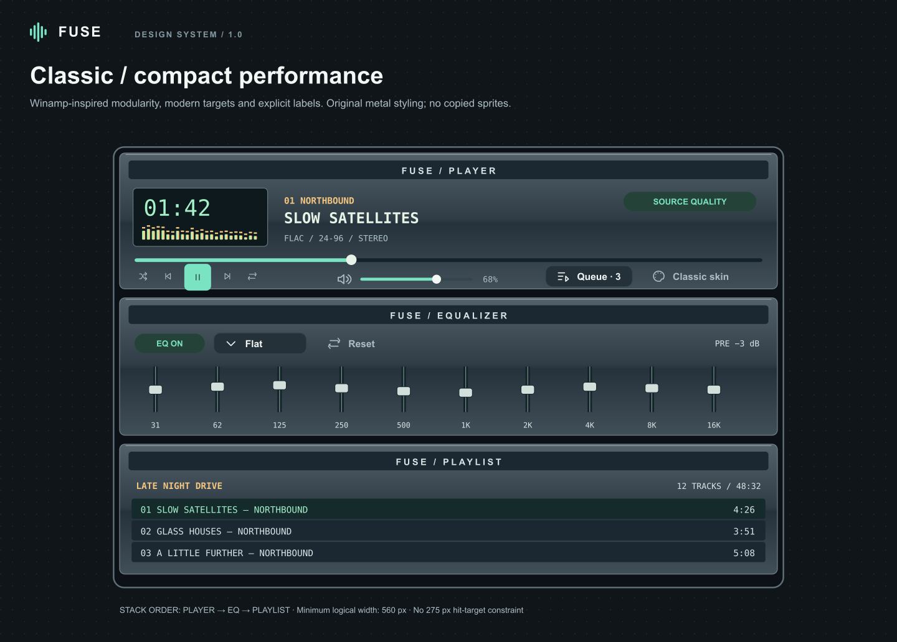
  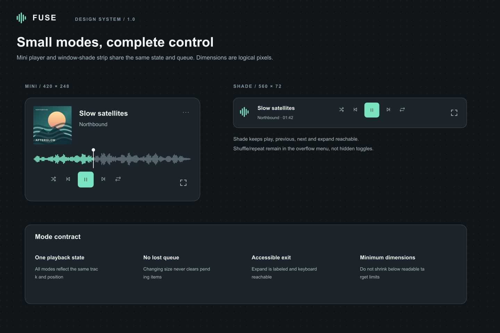
</p>
<p align="center">
  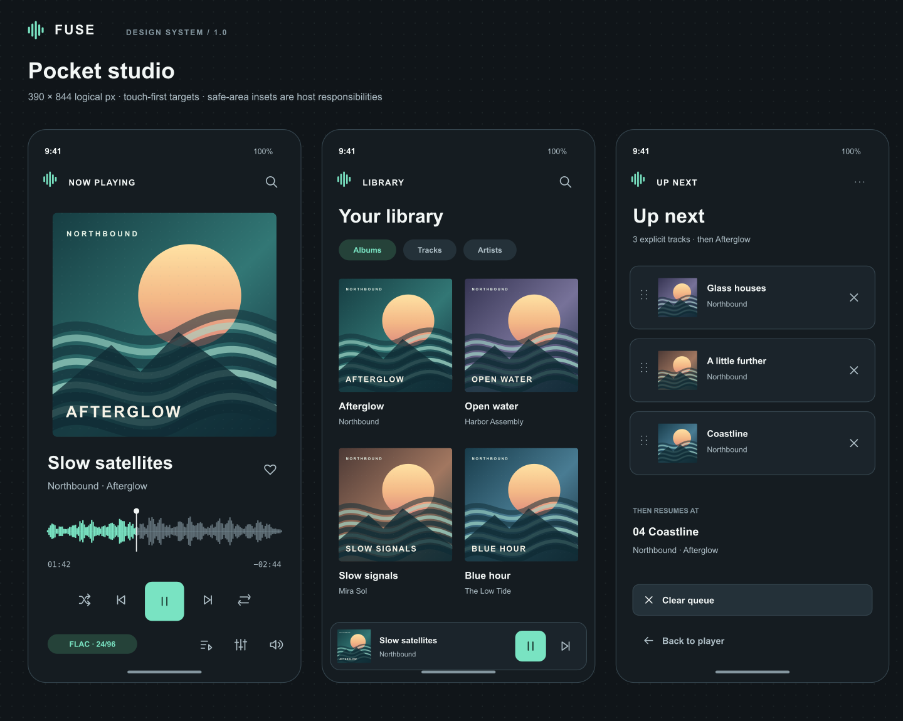
  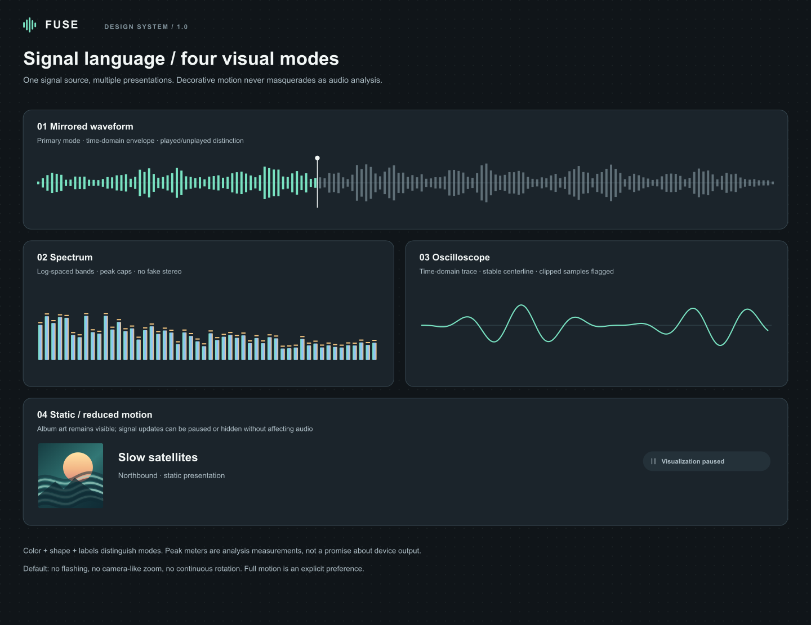
</p>
<p align="center">
  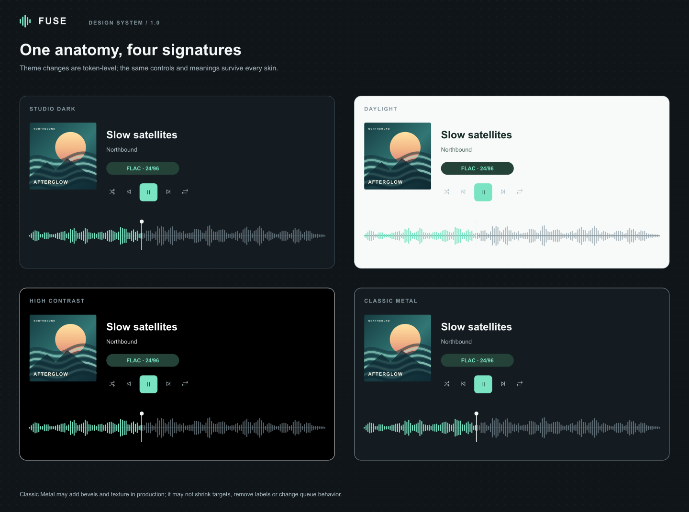
  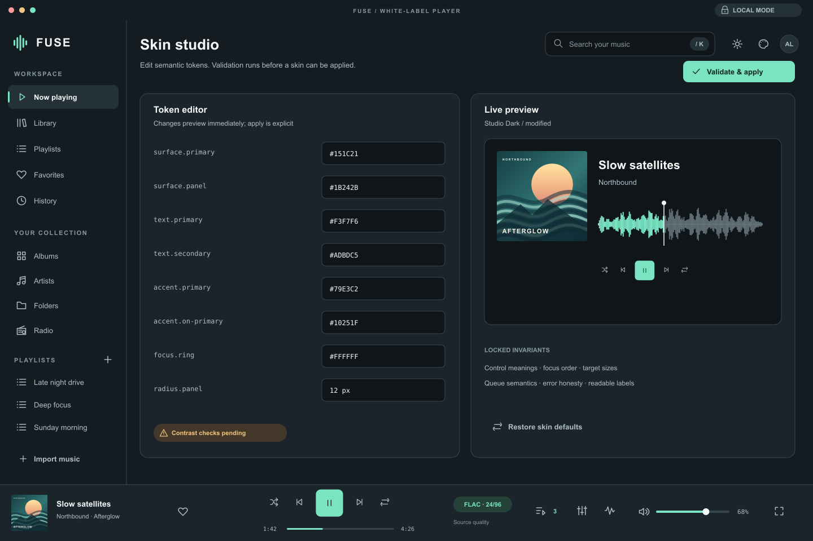
</p>

Full index and embedded SVGs: [`FUSE-Complete-Design.md`](FUSE-Complete-Design.md) (section 16). Editable sources: `fuse-design/svg/`.

---

## Implementation Handoff

Recommended separation: host adapters → core domain → audio engine → presentation. Suggested state shape (`PlaybackState`, `PlayerStore`, `VisualFrame`) and performance targets (100k-track virtualization, 30/20 fps signal, no audio dropouts) are in the spec. Security/privacy: data-only skins, sanitized SVG, opt-in diagnostics, explicit destructive actions.

Handoff checklist (10 items) including platform/audio backend confirmation, semantic control layer, queue store, analysis tap, token resolver, skin validator, localization/RTL fixtures, audits, performance tests, usability tasks.

---

## Validation & Acceptance

- 50 SVG artifacts generated and parsed as valid XML.
- Representative screens rendered to PNG for visual inspection.
- Corrected artwork clipping, control overlap, empty-player semantics, theme leakage, icon-sheet overflow during render review.
- All artwork is original vector geometry; no reference-product sprites or logos.
- Contrast spot checks (computed, not certified) — see spec section 18.2.
- Required test matrix (21 cases) and 10 usability tasks — see spec section 18.3/18.4.

---

## Roadmap

| Phase | Scope |
|---|---|
| Phase 0 — Decisions | Brand/name/logo, platform order, audio backend matrix, DB/playlist portability, privacy policy, skin distribution |
| Phase 1 — Core player | Semantic shell, transport, state machine, local import, library, queue, search, recovery; dark/light/HC tokens; keyboard/focus/zoom; static signal + analysis tap |
| Phase 2 — Differentiators | Focus/mini/shade/Classic modes; reactive SVG; EQ/presets/output chooser; sleep timer; Skin Studio/token editor/import validation; smart playlists, favorites/history, tag editor |
| Phase 3 — Conditional depth | Radio/podcasts/providers; advanced DSP/output; mobile native integrations; converter/CD/recording/scheduler after backend/legal review; localization/RTL; performance hardening |

---

## Repository Structure

```
.
├── README.md                          # this file
├── FUSE-Complete-Design.md            # full spec (20 sections + appendices, embedded SVGs)
├── docs/prompts/research/prompt_01.md # original design prompt
├── fuse-design/
│   ├── docs/                          # 00-front-matter, 01-product-spec, 02-handoff (+ PNG renders)
│   ├── svg/                           # 50 editable SVG sources
│   ├── scripts/                       # make_screens.py, design_core.py, render_checks.js, ...
│   ├── tokens.json                    # machine-readable tokens
│   ├── themes.json                    # studio-dark / daylight / high-contrast
│   ├── skin.schema.json               # data-only skin manifest schema
│   └── fonts/                         # Inter, JetBrains Mono
├── image-search/                      # reference screenshots (Winamp/VOX/AIMP)
└── exports/
    ├── css/fuse-enterprise.css        # enterprise presentation CSS
    ├── formats/                       # HTML, PDF, DOCX, ODT, EPUB + CSS
    └── images/{png,jpeg,pdf}/         # 50 screens in each format
```

---

## Exports

| Deliverable | Path |
|---|---|
| Full specification (Markdown) | `FUSE-Complete-Design.md` |
| Styled HTML | `exports/formats/FUSE-Complete-Design.html` |
| PDF | `exports/formats/FUSE-Complete-Design.pdf` |
| DOCX | `exports/formats/FUSE-Complete-Design.docx` |
| ODT | `exports/formats/FUSE-Complete-Design.odt` |
| EPUB | `exports/formats/FUSE-Complete-Design.epub` |
| PNG screens (50) | `exports/images/png/` |
| JPEG screens (50) | `exports/images/jpeg/` |
| Per-screen PDFs (50) | `exports/images/pdf/` |
| Enterprise CSS | `exports/css/fuse-enterprise.css` |

---

## Source Notes & Limitations

Reference products (VOX, AIMP, Winamp) inspire interaction patterns; no proprietary assets are copied. Public pages are not a substitute for version-specific testing. Premium/platform/plugin differences are treated as capability gates. Accessibility targets are design requirements; formal conformance requires implementation testing. The waveform lab demonstrates browser audio analysis, not a production audio engine. Fictional metadata and original vector sleeves avoid implying real artist endorsements.

No production audio decoder, database, native file-permission layer, or platform media-session integration is implemented. No formal usability study, screen-reader certification, or WCAG conformance audit has been performed. Mobile screens are design concepts; native gesture, safe-area, and background-audio behavior remain implementation work.

---

### License & Reuse

The design specification and original SVG artwork are provided as project deliverables for adaptation. Third-party fonts (Inter, JetBrains Mono) — their licenses are included in `fuse-design/fonts/` when present; final production font embedding/redistribution must follow the applicable font license. Reference-product names are used only for analysis and attribution.

<p align="center">
  <sub>FUSE · White-label Music Player UI/UX Fusion · Design study & implementation handoff · 25 November 2026</sub>
</p>
